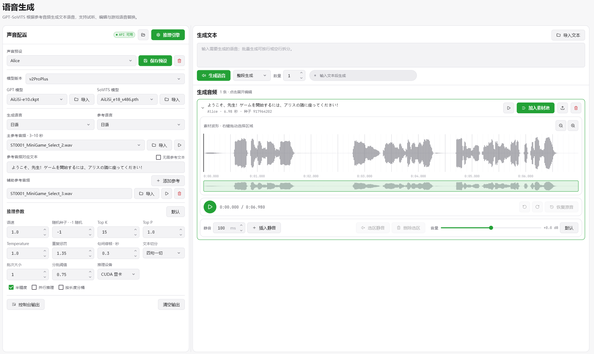
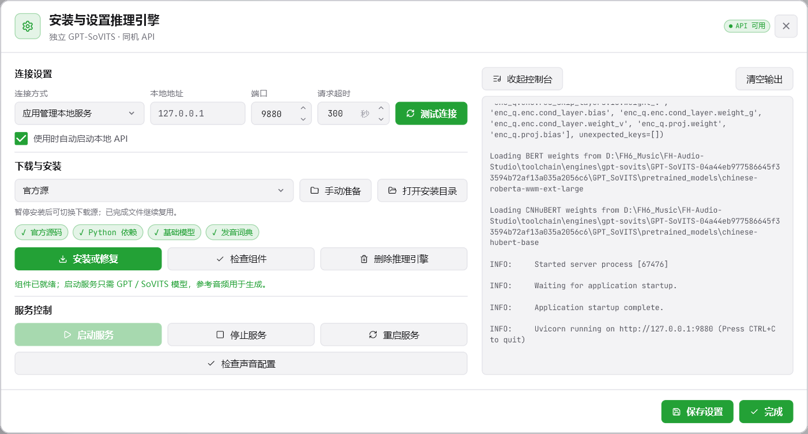
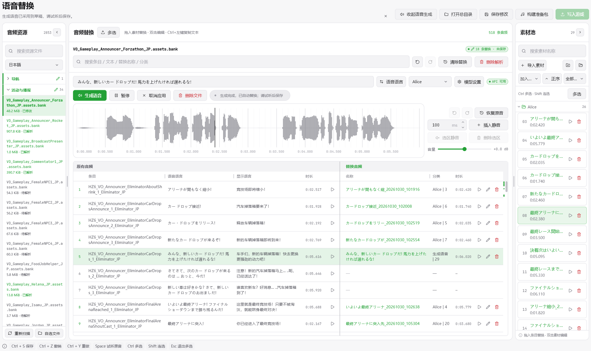

# 功能介绍

本文对应 `v1.0.0-preview.2`。主程序已整合歌曲、播放列表、电台台呼、语音替换、GPT-SoVITS 语音生成及素材编辑；界面概览见 [README](../README.md)。

## 工程、环境与备份

新建工程后，歌曲、编辑信息、原始备份和准备包都保存在所选工程中。新工程完整路径需使用英文、数字或常用英文符号，以避免部分构建工具的路径兼容问题。打开已有工程不会将其替换为演示工程。

- 首次运行先在概览检查 Python、音频工具、游戏目录与语言。Windows 包需要完整解压，不能只移动 EXE。
- 标准备份包括歌曲 bank、RadioInfo 和原有电台台呼文件；语音资源在首次解析前另行保存原文件快照。语言偏好与 StringTables 文本文件用于识别和读取，不会作为写入文件覆盖游戏。
- 保存歌曲、播放列表或台呼只保存工程配置，构建生成准备包，写入操作才会改动所选游戏目录。
- 工程搬迁后请重新打开工程目录；不要在文件管理器中随意改名已导入音频。备份和源码发布包不会替代个人工程备份。

## 基础设置与分析模式

识别游戏目录及游戏中的显示语言和语音语言，并在工程中保留选择。显示语言用于文本对照，语音语言用于音频资源与原音试听；语音替换页面的两列文本跟随设置，切换后重新读取。这里不改写游戏语言偏好或旧文本包。分场景编辑开关位于播放列表；语音生成与塞壬唱片入口在设置的功能区管理。

| 设置 | 用途 |
| --- | --- |
| 分析模式 | 无 AI 可直接读波形并手动配置；其他档位按需使用本地模型分析。 |
| PL 自动同步 TL | TL 为比赛中循环，PL 为冲线后循环；开启后同步端点和确认状态，可在歌曲中临时暂停关联。 |
| SeamlessLoopMusic | 查找循环前后音高与响度更接近的 TL／PL 候选。默认启用，无 AI 模式也可用。 |
| 电台扩容 | 允许歌曲数量超过原版容量，仍受实际 bank 大小与构建检查限制。实验功能。 |
| 分场景编辑 | 分别编排漫游和比赛，需要先开启电台扩容。实验功能。 |

推荐先使用“无 AI＋SeamlessLoopMusic”处理循环，再根据需要启用 AI 的节拍、结构及播放起点分析。引擎评分是参考，不代表最终听感；候选套用后仍应试听确认。

## 自建歌曲与元信息

支持本地音频选择与外部文件拖入，导入时显示转换进度和结果；相同文件内容可识别复用。塞壬唱片提供浏览、试听与导入入口，可在设置中控制显示。

列表展示总数、已配置、待完成、未分配、时长、BPM、配置进度和电台归属。搜索歌曲／歌手／文件名，结合状态、电台、场景和排序筛选。待完成歌曲始终优先显示；默认按文件名称排序，也可选择歌曲名、歌手名或修改日期；表格列宽可拖动，双击恢复。

### 歌曲信息与 BPM

歌曲页的「编辑歌曲信息」可修改曲名、歌手与 BPM，保存后用于下一次构建与写入，不修改源音频标签或文件名。信息优先使用手动保存的显示值，其次使用导入资料和音频标签；缺少信息时才按文件名回退。普通文件名猜测遵循“歌手 - 歌名”，半角横线两侧需有空格，不会自动移除任意前缀数字。

同一窗口中的 BPM 支持手动输入、减半、加倍，范围为 20–400。应用后更新拍线与按拍微调步长，歌曲现有时间点保持原位置；点击歌曲页保存，重新分析保留手动值。自动检测可能出现半速／倍速，需结合听感核对。数字输入沿用界面数值字体。

## 歌曲编辑与人工精修

四组配置共六个时间点，卡片按 TD、TL、PD、PL 排列：

| 配置 | 作用 |
| --- | --- |
| TD · TrackDrop | 比赛开始时的播放起点。 |
| TL · TrackLoop | 比赛中的循环起点和终点。 |
| PD · PostDrop | 冲线后的播放起点。 |
| PL · PostLoop | 冲线后的循环起点和终点。 |

歌曲可连续切换、分配电台、修改信息并保存。卡片悬停高亮，Ctrl＋左键快速试听，双击进入人工精修，Ctrl＋右键快速确认。只用于漫游的歌曲无需确认比赛点位；只要同一音源用于任一电台比赛列表，仍需要完整配置并确认。

- 左键移动播放指针，右键放置或拖动端点；循环可分别选择 A／B。
- Ctrl＋滚轮缩放，下方缩略波形移动视野；缩放上限按波形细节控制。
- 输入时间或使用按拍、10ms、1ms 微调，可磁吸到拍或自由放置；组合键支持两端同时移动。
- 播放栏集中提供播放／暂停、撤销、重做、取播放位置及试听。循环建议可套用并继续调整，与已保存配置比较。SeamlessLoopMusic 候选还展示两端音高偏差（note_difference），与匹配度一起辅助判断，不能替代试听。
- 确认选点后回歌曲页保存。离开未保存内容时可按提示处理；编辑器会在切换页面时退出并释放播放资源。

### 试听设置

TD／PD 分别设置起点试听时长；TL／PL 分别设置 B 点前与 A 点后的衔接试听长度。循环试听检查一次 B→A 后停止，音量也在此调整。设置影响试听，不改变歌曲时间点。

### 时间点导入导出

导入支持粘贴表格文本，以及 TXT、CSV、TSV、JSON、XLSX 和 RadioInfo XML。先选择歌曲标识匹配规则、时间格式与覆盖选项，再预览匹配、范围与错误；确认后才应用，导入前自动备份。可选择按 Radio_station 列分配电台，并将完整时间组标记为已确认。

常用列为 `Filename, TD, PD, TL-A, TL-B, PL-A, PL-B`；`Radio_station` 可选。支持秒数、`分:秒.毫秒` 和 48kHz 整数采样点。自动匹配要求结果唯一，重名时建议用文件名；遗漏的列、显式空值与覆盖选项按导入预览处理。

导出读取工程中已保存的时间点，未配置项留空；可选文件标识、时间或采样点格式及电台归属，保存为 CSV。导出前先保存歌曲中的修改。

## 播放列表与场景编排

“准备包”编辑下一次构建的排布，“游戏内”只读核对当前 RadioInfo。支持复制游戏内排布、拖动排序、跨电台移动、拖回池子、多选批量分配及撤销／重做；保存后记录工程排布。

歌曲池支持搜索、排序、状态、电台和场景筛选。Ctrl 多选、Shift 连选，Esc 退出；多选工具统一为已选数量、全选、清空和分配至电台，正常池宽下保持同行。同曲分配多个电台会在分配、播放列表和构建前提供提示。

分配窗口支持鼠标、数字键与小键盘。统一编排时 `1–9` 选择电台；开启分场景后，数字键分配比赛，Ctrl＋数字分配漫游。

分场景可分别安排 FreeRoam 和 Event。关闭时选择一套用于统一编排，并保留原两套快照；再次开启恢复快照，统一期间的改动不会自动并入。可在电台标题右侧套用另一场景歌单；同一电台不支持一边原版、一边自建，两场景共用音频库，容量按去重音源检查。

仅漫游使用的歌曲，构建时为缺少的比赛点位补安全默认值，不覆盖工程点位、确认状态或自动运行 AI。扩容使用期间不能关闭；需先关闭分场景，并使曲目数量回到原版限制内。

## 电台台呼

原有台呼可试听，准备包中可导入、拖入素材并分配到现有台呼位置。台呼之间拖动交换，Ctrl 拖动复制，拖回池子清除分配；素材池支持搜索、筛选、排序、多选、删除和快捷分配。当前版本不提供增加台呼位置的扩容功能。

排布和编辑先保存在草稿，手动保存后用于构建；拖动不会逐次重构 bank。构建前若存在未保存内容会提示处理。单个预览失败不会隐藏其他电台和素材，页面会给出具体素材及原因，仍可继续编辑。

A／B 控制裁剪范围，“下一首开始”控制后续歌曲进入位置，可输入时间、右键调整或取播放位置。左右键默认按 300ms 微调，Shift 配合为 10ms，Ctrl 配合为 1ms。原有台呼为只读，替换素材可调整音量并应用到草稿。

可选择前后试听歌曲，优先使用对应电台已分配的歌曲，并缓存选择。衔接试听默认前 6 秒、后 4 秒，时长可改；前后歌曲不计入台呼波形时间轴，A／B 与下一首进入位置保持台呼自身的时间。

构建前可统一叠加 -6 至 +6dB 增益并试听。台呼与歌曲使用同一份 RadioInfo 合并检查；仅保留实际改动和必要配置，未改动或与游戏一致的文件不会因为曾编辑过而重复带入准备包。需要恢复现有改动时，原版文件仍可能作为恢复操作加入清单。

## 语音资源与替换

左侧按类别和语言显示扫描到的音频资源、大小与状态，也支持自选文件。已解析使用强调色文字，已修改使用强调色粗体与左侧竖线，父级同步标记；暂不可解析资源放在末尾并说明原因。

选中文件后确认备份与解析，一次准备该文件的全部条目和试听音频。结果保存在工程并复用，切换文件或页面保留草稿与缓存，不要求先保存或撤回。歌曲和台呼资源优先在专门页面处理，其他资源能否替换以格式检查结果为准，不以文件名是否含 assets 判断。

中间对照表左侧为原音、序号、条目、文本、时长与试听，右侧为替换名称、文件夹／序号、时长和操作。文本分别跟随概览的语音语言和显示语言；从游戏语言资源关联，找不到时留空，不自动编造字幕。Ctrl＋左键复制文本，结果在底部提示。

表格支持列宽调整、双击恢复、搜索原音与替换信息；右侧滚动位置标记修改条目，点击直接跳转。两种多选均支持 Esc 退出；进入多选会恢复页面键盘焦点，即使此前焦点在其他区域或搜索框也可退出。

拖入池中素材或外部文件到指定替换栏完成替换，双击替换项编辑，删除直接撤回该项替换。保留原条目索引与名称，不提供 Ctrl＋D“替换所选条目”的隐式操作。支持撤销、重做与整文件清除替换。

### 导出语音文本

在标题旁进入多选，勾选原音条目后导出文本；表头可选择全部条目。导出支持 TXT、CSV、XLSX，选项实时更新预览，也可复制结果；字段包括条目名称、语音语言、显示语言和时长，可只包含已关联文本的条目。文件名为 `资源文件名_语音文本导出.扩展名`，不额外输出资源文件列。

### 语音素材编辑

素材池可建立文件夹与子文件夹，重命名、移动、多选、拖动和删除；未分类置于末尾。已使用素材保持白色背景、灰色边框，保留原有信息样式；素材编号可在替换表的“文件夹 | 序号”中核对。

- 双击编辑，左键移动播放指针，右键拖出选区。
- 在指针处插入静音，默认 100ms，上下按钮每次增减 50ms。
- 对选区静音或删除；操作后播放指针保持原时间，超出新结尾时只钳制到结尾。
- 调整音量，撤销、重做或恢复原音；保留编辑前原始素材以便恢复；从素材池删除时会清理工具管理的素材文件及关联替换，不删除外部导入原文件。
- 替换项默认使用实际编辑时长，可选保持原时长，不足补静音、超出裁剪。游戏自身事件可能限制播放长度，需实际验证。

## GPT-SoVITS 语音生成（实验功能）

语音生成默认显示，可在设置的功能区关闭。使用独立 GPT-SoVITS 官方 api_v2，不依赖 GAG，也不提供音色转换或模型训练功能。

### 安装与连接

- 可由应用安装并管理本地推理服务，也可连接已有同机 API；默认地址为 `127.0.0.1:9880`。
- 自动安装仅准备推理所需的源码、依赖、基础模型与词典，不打包训练界面和训练数据。不同模型家族可能需要首次额外下载。
- 可选官方源、内置镜像或自定义源；显示下载速度、当前文件和总体阶段进度，支持手动准备、暂停续装及后台安装。下载保留 HTTPS 校验，失败时尝试可用备用地址。
- 安装期间关闭窗口或切换页面会提示处理；后台任务在主界面显示进度。退出应用前处理未完成安装，下次可继续。
- API 状态与声音配置分别检查。启动服务需要 GPT／SoVITS 模型，参考音频在生成时校验。只停止应用自行启动的服务，不关闭外部 API 进程。
- 控制台可展开、手动清空，应用结束后清理；删除推理引擎保留已导入的模型、参考、预设和工程素材。

### 声音、参数与结果

导入 GPT 与 SoVITS 模型并选择版本，导入主参考音频（3–10 秒）及其准确文本，选择生成语言与参考语言。辅助参考可逐项导入、试听和移除。模型与参考文件保存在工具链中，显示原文件名；旧记录无法核实原名时明确提示，不编造名称。

语速、种子、Top K／Top P、Temperature、重复惩罚、切句、句间停顿和性能参数可调整，数值支持输入及上下微调，参数按窗口宽度排列。模型、参考和参数可保存为声音预设；保存后有提示，未保存修改用 * 标识。删除预设不会删除文件。

右侧输入或导入文本，支持整段、按行、按空行批量生成及反复重试；显示完成、剩余、失败和排队状态，可暂停或取消。新结果展开波形，旧结果折叠；可试听、编辑、加入素材池、导出或删除。加入后未修改的结果显示「已加入素材池」，编辑后可再次采用。文件使用文本摘要和短唯一后缀命名，避免冲突。

### 在语音替换页面生成

引擎未配置时提供前往配置的提示；就绪后在当前工作区打开生成面板。选择条目，切换语音语言／显示语言的文本，也可手动修改，再选择声音预设生成。多选时可批量生成，并选择跳过已有替换。

生成完成自动更新对应替换草稿，试听后需保存；切页保留文本、预设和编辑状态。没有结果或生成期间保留空波形背景，编辑控件禁用，避免界面跳动。取消应用只移除当前应用并保留文件；删除文件同步清除关联替换与预览。波形旁提供静音、删除选区、音量、撤销重做和恢复原音。

不使用游戏原音作为声音参考，不自动匹配原音时长；参考仅来自预设中的主／辅助参考。生成质量取决于模型、语言、参考和文本，游戏事件也可能限制播放长度，仍应试听及游戏内验证。

完整配置与文件说明见 [GPT-SoVITS 使用说明](gpt-sovits.md)。

## 构建、写入与恢复

歌曲构建前可试听统一响度、切换试听歌曲和位置，并调整 Vorbis 质量（1–100，默认 50）。文件大小为估计，最终以实际构建校验为准。未变化的 bank 可复用，临时音频按阶段释放；构建可取消并保留之前完成的准备包。

歌曲与台呼的准备包从概览写入，语音替换页面提供独立的构建与写入按钮，两类准备包分别管理。写入窗口列出预期目标相对路径、文件大小和作用，可逐文件勾选。写入前退出游戏并核对关联配置，不建议随意拆分存在依赖的音频与配置文件。

默认写入 `mediapc` 覆盖目录，保留 `media` 原文件，也可选择直接写入 `media`。原文件备份、所有权与一致性检查按当前写入方案处理；恢复应使用与当前游戏版本对应的备份。写入前比较目标内容，只处理实际有变化的文件；语言偏好与 StringTables 不写入游戏。

仅打开准备包目录也能替换。若文件被其他程序独占，保留已完成的新包，解除占用后可重试，重试使用已完成的构建快照，不包含之后的编辑。

### 游戏更新后的处理

重新检查当前游戏资源与原始备份，旧准备包不直接覆盖新版本；重新建立原始备份会保留歌曲、时间点和歌单制作。语音 bank 更新后按唯一声音标识或名称迁移替换，不按旧序号猜测；无法匹配的旧制作存档并提示核对，存在冲突时停止对应文件的重构。资源清单、文本和试听缓存随资源与语言变化刷新。

更新期间不要同时构建或写入。具体的文件一致性、缓存失效与冲突处理见 [游戏更新说明](game-updates.md)。

## 外观、快捷键与功能介绍

主题、强调色、侧栏／顶部导航、页面宽度和人工精修窗口宽度可调。台呼、语音素材编辑复用歌曲精修的弹窗位置与布局，侧栏高度随主编辑区保持一致。

默认撤销 Ctrl＋Z，重做 Ctrl＋Y，保存 Ctrl＋S。歌曲／台呼分配保留各自快捷入口；语音替换没有“快捷替换所选”操作。精修窗口下方显示当前快捷键，可在设置中修改支持的按键并检查冲突。

首次进入页面提供画框引导，右上角问号可重看。语音替换完整页面为五步：资源、原音与替换、素材池、搜索与批量操作、保存／构建／写入；两个操作区分别框选。台呼编辑只介绍波形、播放、时间点和设置四个模块。语音生成仅在声音配置完整且 API 可用、空闲时介绍 API、模型、参考与语言、参数、生成文本与音频五部分；首次在替换页启用生成时提供三步简短介绍。

## 工程文件位置

| 位置 | 内容 |
| --- | --- |
| `sources/` | 歌曲音频。 |
| `sources/stingers/`、`sources/voices/` | 导入的台呼／语音素材。 |
| `.fh-radio-studio/` | 工程配置、歌曲信息、已保存的分配与编辑记录。 |
| `.fh-radio-studio/stingers/baselines/`、`voices/baselines/` | 台呼与语音原文件快照。 |
| 工具链 `engines/gpt-sovits/` | 推理引擎、导入模型、参考音频和声音预设；不随发布包携带个人声音配置。 |
| `analysis/voices/generation/` | 生成任务、结果和预览编辑缓存。 |
| `analysis/` | 分析结果、波形、解析和试听缓存。 |
| `packages/current/` | 歌曲与台呼准备包。 |
| `packages/voices-current/` | 独立语音准备包。 |
| `backups/` | 标准原始备份及操作备份。 |

请保留整个工程，勿将缓存目录、素材目录或备份单独移走后继续编辑。发布包不携带个人工程、歌曲、历史设置或已生成的用户环境。

## 验证范围与反馈

各次测试的数量、构建校验和未验证内容以[版本更新说明](releases/v1.0.0-preview.2.md)和本地审查记录为准。自动化检查不能替代所有游戏事件、全部语言资源、全部 AI 模型和实际听感验证。

[问题反馈](https://github.com/buuuuuuuuuug/FH-Audio-Studio/issues) · [来源与分发说明](third-party-notices.md) · [开发说明](development.md)
